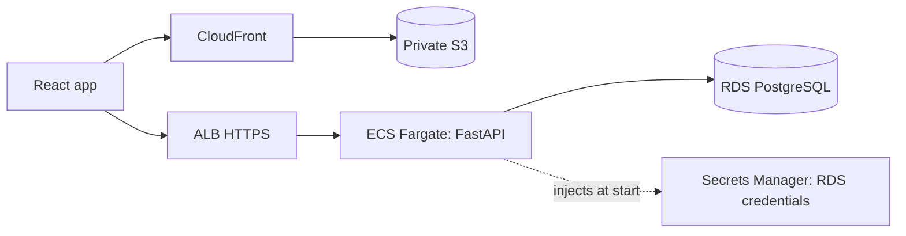

# Enterprise profile

For large applications, SaaS, and systems that need AWS depth. The web app is served from S3 through CloudFront; the FastAPI API runs on ECS Fargate behind an ALB with HTTPS; PostgreSQL is private RDS.

Modules: `aws/vpc`, `aws/ecr`, `aws/ecs-service`, `aws/rds-postgres`, `aws/s3-static-site`, `aws/cloudfront`, `aws/github-oidc`.

## Reference projects

- API: `template-api-python` with the default Dockerfile target. ECS injects the RDS-managed credentials secret as `POSTGRES_CREDENTIALS_JSON`; the app also gets `POSTGRES_SSL_MODE=require` and `CORS_ALLOWED_ORIGINS`. The ALB checks `/health` (liveness), so a database outage does not recycle tasks. Run `alembic upgrade head` as a separate one-off task with the same image.
- Web: `template-react-vite`, built with `VITE_API_BASE_URL=https://<api hostname>` and published with the `web-publish` role (`aws s3 sync dist/` plus a CloudFront invalidation, both from the GitHub environment).

## Use

1. Create and validate the ACM certificates: one in the region for the API hostname, and one in us-east-1 for custom web hostnames (skip if you use the default CloudFront hostname).
2. Bootstrap: `terraform apply -target=module.repository -target=module.github`, passing the placeholder values from `terraform.tfvars.example` for the other required inputs. Push the image with `docker-push` and set `api_image_uri` to the digest.
3. Apply everything, then point the API hostname at `api_load_balancer_hostname`.
4. Build and publish the web app. Add `web_aliases` and DNS when you want a custom web hostname.

## Limits you should know

- The application connects with the RDS master credentials. Creating a least-privilege application user is a separate step (TBD).
- NAT gateways, the ALB, and RDS have recurring costs (TBD). Turning NAT off is unsupported without custom additions: private tasks would need VPC endpoints for ECR (including an S3 gateway endpoint for image layers), Secrets Manager, and logs, and the profile defines none.
- The ALB allows `0.0.0.0/0` on HTTPS by default; set `api_allowed_ingress_cidrs` when the API is not public.
- Terraform owns the task definition, so releases change `api_image_uri` and apply. The new digest probably replaces the task definition (unverified), so the `terraform-apply` workflow needs `allow-destroy: true`; read the plan's delete list first.
- RDS rotates the master secret automatically and ECS reads it only when a task starts, so tasks started before a rotation fail to reconnect until replaced. Restart the service after a rotation or add re-read logic to the application (TBD).
- The `ecr-push` and `web-publish` roles trust only the GitHub environment named in `github_environment`; protect that environment with deployment rules and reviewers. Database teardown requires disabling deletion protection through a reviewed change.

## Not verified

Everything that needs a real account: IAM permissions, ECS task startup and health, ALB and ACM, RDS connectivity and SSL, CloudFront and OAC behavior, OIDC role assumption, and cost.
