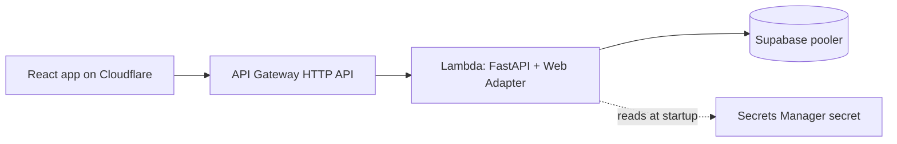

# Lean profile

For freelance work, MVPs, and early-stage products with low traffic. The web app is a Cloudflare Workers static site; the FastAPI API runs as a container image on Lambda behind an API Gateway HTTP API; PostgreSQL is a Supabase project that you create by hand.

Modules: `cloudflare/domain`, `cloudflare/static-site`, `aws/ecr`, `aws/lambda-fastapi`, `aws/github-oidc`.

## Reference projects

- API: `template-api-python`, built with `docker build --target lambda .` (adds the Lambda Web Adapter and boto3). Settings the profile sets: `POSTGRES_SSL_MODE=require`, `POSTGRES_POOL_MODE=null`, `POSTGRES_CREDENTIALS_SECRET_ARN`, `CORS_ALLOWED_ORIGINS`. Run migrations as a separate one-off step against the direct or session-pooler connection.
- Web: `template-react-vite`, built with `VITE_API_BASE_URL=<api_endpoint output>`; the profile serves it with `spa_mode = true`.

## Use

1. Create the Supabase project. Create a Secrets Manager secret by hand with `{"username": "...", "password": "..."}` and pass its ARN as `database_secret_arn`. Terraform never reads the value.
2. Bootstrap: `terraform apply -target=module.repository -target=module.github`, passing the placeholder values from `terraform.tfvars.example` for the other required inputs (`web_assets_directory` must be a directory that contains any `index.html`). Push the image with the `docker-push` workflow and `target: lambda` (role from `ecr_push_role_arn`, job in the GitHub environment named by `github_environment`).
3. Set `api_image_uri` to the pushed digest and apply everything. This publishes the placeholder web directory and returns `api_endpoint`.
4. Build the web app with `VITE_API_BASE_URL` set to `api_endpoint`, point `web_assets_directory` at the build, and apply again.
5. If the zone is new, set the returned `nameservers` at the registrar by hand.

## Inputs

See `variables.tf` and `terraform.tfvars.example`. Notable: `postgres_host` and `postgres_port` (the Supabase pooler; the transaction pooler is normally on 6543), `github_repository`, `github_environment`, `existing_zone_id`, and `create_github_provider` (an account can hold one GitHub OIDC provider).

## Cost and limits

The target is about $0-10/month, unverified. Lambda, API Gateway, Cloudflare, and Supabase have free tiers whose limits change; a Secrets Manager secret is a small monthly charge (TBD). The API is public, so the application must implement authentication, and the throttling defaults of the Lambda module apply.

## Not verified

Lambda Web Adapter behavior inside Lambda, cold starts and pooler limits against Supabase, whether the pooler hostname is reachable from Lambda over IPv4 (confirm in the Supabase dashboard), API Gateway behavior, Cloudflare activation, OIDC role assumption, and cost.
