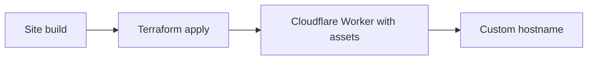

# Static profile

For portfolios, documentation, marketing sites, and landing pages. A built site is uploaded as a Cloudflare Workers static-assets Worker and bound to a hostname on an owned domain.



Modules: [`cloudflare/domain`](../../cloudflare/domain/README.md) (only when the zone does not exist yet) and [`cloudflare/static-site`](../../cloudflare/static-site/README.md).

## Reference projects

- `template-docs`: build with `DOCS_URL=https://<hostname> DOCS_BASE_URL=/ npm run build`, then use `build/` as `assets_directory`. Leave `spa_mode = false` so unknown paths return 404.
- `template-react-vite`: build with `VITE_API_BASE_URL` set, use `dist/` as `assets_directory`, and set `spa_mode = true`.

## Use

1. Own the domain. Reuse an existing Cloudflare zone through `existing_zone_id`, or let Terraform create the zone and then set the returned `nameservers` at the registrar by hand.
2. Build the site, then copy `terraform.tfvars.example` to a git-ignored `terraform.tfvars` and fill it in.
3. `terraform init`, review `terraform plan`, then apply with an API token scoped to the account's Workers scripts and the zone.
4. A content change needs a rebuild and another apply.

## Release workflow

Build the site in one job and hand it to the reusable Terraform workflow from [github-workflows](https://github.com/alonsovndev/github-workflows) as an artifact. The workflow reference below assumes the `v1` tag exists, which is TBD.

```yaml
jobs:
  build:
    runs-on: ubuntu-latest
    steps:
      - uses: actions/checkout@v4
      - uses: actions/setup-node@v4
        with:
          node-version-file: .nvmrc
      - run: npm ci && npm run build
      - uses: actions/upload-artifact@v4
        with:
          name: site
          path: build

  apply:
    needs: build
    uses: alonsovndev/github-workflows/.github/workflows/terraform-apply.yml@v1
    permissions:
      contents: read
      id-token: write
    with:
      environment: production
      working-directory: infra/profiles/static
      artifact-name: site
      artifact-path: site
      aws-region: us-east-1 # the state backend's role; TBD per project
      backend-config: |
        bucket=example-terraform-state
        key=example/static.tfstate
        region=us-east-1
      role-arn: arn:aws:iam::111111111111:role/example-apply
    secrets:
      CLOUDFLARE_API_TOKEN: ${{ secrets.CLOUDFLARE_API_TOKEN }}
```

Set `assets_directory = "./site"` in the variables. Use `terraform-plan` on pull requests with a read-only Cloudflare token. The AWS role and region are for remote state only; a different backend is a project decision (TBD).

## Inputs

| Input | Purpose |
|---|---|
| `account_id`, `site_name` | Cloudflare account and Worker name |
| `domain`, `hostname` | Owned apex domain and the hostname to serve (the domain or a subdomain) |
| `existing_zone_id` | Skip zone creation when the zone already exists |
| `assets_directory` | Built site containing `index.html` |
| `spa_mode` | Serve `index.html` for unknown paths |

## Not verified

Asset upload, certificate issuance, DNS activation, content-change redeployment, and the exact API-token permissions need a live account. Cost is unverified.
